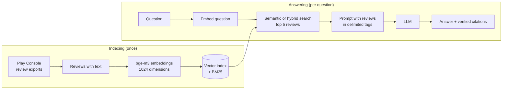

# App Review RAG

A question-answering service over the Google Play reviews of **your own Android app**.
It retrieves the relevant reviews, answers **only** from them, and checks every cited
source. Every design choice, from the prompt to the search strategy, is measured
against hand-labelled data.

Fork it, point it at your Play Console review exports, adapt the prompts to your app,
and you get:

- answers to questions like *"what problems do users report with the new editor?"*,
  with citations you can verify;
- structured analysis of each review: sentiment, topic, bug report, summary;
- an evaluation loop to measure prompt and retrieval changes on your own data.

> Work in progress: a learning project towards production RAG and agent systems on Azure.
> Current state: local models on Ollama. See the [roadmap](#roadmap).

## Why retrieval matters

Same model (`qwen2.5:7b`), same question about how to use a feature of the app:

| Without retrieval (`/chat`) | With retrieval (`/ask`) |
|---|---|
| Seven confident steps through menus that do not exist | "The reviews do not explain how to do this; some users report problems with it", with the sources |

Without sources the model invents. With sources and strict rules, it says what the
sources do and do not contain.

## How it works



1. **Retrieve**: the question is embedded with `bge-m3` (multilingual) and compared with
   every review by cosine similarity. Optional hybrid mode fuses BM25 keyword search
   with reciprocal rank fusion.
2. **Augment**: the top reviews go into the prompt inside delimited tags, with their id,
   rating, month and app version. Review text is escaped so it cannot close its tag.
3. **Generate**: the model must answer only from the reviews, cite each claim by review
   id, and say so when the sources are not enough.
4. **Verify**: every cited id is checked against the retrieved reviews. Unknown ids are
   returned separately as fabricated citations.

## Example results

Measured on a real Android photo and video editing app: about 68,000 reviews, 11,692 of
them with text, from 2013 to 2026, in many languages. Your numbers will differ: the
point is that you can measure them. Logs in [`docs/`](docs/).

**Review classification** (20 reviews, 4 per star rating, labelled by hand,
[details](docs/Run1/evaluation.md)):

| Field | qwen2.5:1.5b | qwen2.5:7b, initial prompt | qwen2.5:7b, best prompt |
|---|---:|---:|---:|
| Sentiment | 65% | 65% | **75%** |
| Topic | 40% | 65% | 60% |
| Bug report detection | 80% | **100%** | **100%** |
| Invalid JSON | 0/20 | 0/20 | 0/20 |

Six prompt runs, one change at a time; two were rejected after error analysis
([runs 2–6](docs/Run2/evaluation.md)). A repeat run with no changes gave identical
results, so differences between runs come from the prompt, not from chance.

**Retrieval** (precision@5 on 7 queries in English and Italian,
[details](docs/hybrid-search.md)):

| Keyword (BM25) | Semantic | Hybrid (RRF) |
|---:|---:|---:|
| 60% | **94%** | 83% |

Hybrid search did **not** beat semantic search on this data: the reviews are mostly in
English, so function words of other languages are rare in them and get a high keyword
weight. Semantic search is the default; measure both on your data.

**RAG answers** (six questions, retrieval and generation judged separately,
[details](docs/rag.md)): 0 fabricated citation ids; 3 of 3 unanswerable questions
correctly declined; main open problem is incomplete synthesis, with on average 2 of 5
relevant reviews used.

## API

| Method | Path | Description |
|---|---|---|
| `POST` | `/ask` | RAG answer with verified citations and the ids of the retrieved reviews |
| `POST` | `/reviews/analyze` | Structured analysis of one review: sentiment, topic, bug report, summary |
| `POST` | `/chat` | Plain chat with the model, no retrieval |
| `POST` | `/chat/stream` | Same as `/chat`, streamed as Server-Sent Events |
| `GET` | `/info` | App name and model in use |
| `GET` | `/health` | Liveness check |

Example:

```bash
curl -s -X POST http://localhost:8000/ask \
  -H "Content-Type: application/json" \
  -d '{"question": "What problems do users report when saving videos?", "mode": "semantic", "k": 5}'
```

Errors from the model provider map to `503` (unreachable), `504` (timeout) and `502`
(invalid output) through one exception handler; streaming errors after the first token
are sent as an SSE `error` event.

## Tech stack

- **Python 3.12**, [uv](https://docs.astral.sh/uv/), FastAPI, Pydantic, pydantic-settings
- **Models** (local, via [Ollama](https://ollama.com)'s OpenAI-compatible API):
  `qwen2.5:7b` for generation, `bge-m3` for embeddings
- **Search**: numpy (exact cosine similarity), `rank-bm25`, reciprocal rank fusion
- **Quality**: pytest with an injected fake model (no model calls in tests), Ruff

The model provider sits behind one client class: any OpenAI-compatible endpoint works by
changing `LLM_BASE_URL`, `LLM_MODEL` and `LLM_API_KEY`.

## Getting started

Requirements: [uv](https://docs.astral.sh/uv/) and [Ollama](https://ollama.com).

```bash
git clone https://github.com/GrilloLuca/glitch-rag.git
cd glitch-rag
uv sync
cp .env.example .env

ollama pull qwen2.5:7b
ollama pull bge-m3

uv run pytest                          # no model needed
uv run fastapi dev app/main.py         # API on http://localhost:8000, docs at /docs
```

`/chat`, `/chat/stream` and `/reviews/analyze` work straight away. `/ask` needs a search
index built from your reviews (next section).

## Using your own app's reviews

### 1. Export the reviews

In the Play Console: **Download reports → Reviews**, pick your app and the months you
want, and save the CSV files in `data/reviews/` (one file per month, e.g.
`reviews_<package>_202609.csv`). Older months can also be downloaded from the Google
Cloud Storage bucket linked to your developer account.

The files are UTF-16 encoded. The columns used are `Review Text`, `Star Rating`,
`Reviewer Language`, `App Version Name` and `Review Submit Millis Since Epoch`; if
Google renames them, update `app/reviews_source.py`.

`data/` is in `.gitignore`: reviews are user data and must never be committed.

### 2. Describe your app

Set the app's name and a one-line description in `.env`:

```bash
APP_NAME="PhotoFix RAG"
APP_DESCRIPTION="PhotoFix, an Android app for retouching photos"
```

The description is inserted into every prompt (chat, review analysis and RAG), so the
model knows which app the reviews are about.

Then adapt the **topic labels** to your app's features, in `app/analysis.py`: the
`Topic` labels and `TOPIC_DEFINITIONS`, which define each label for the model. Change
them together. Pick 5–8 areas users actually write about, plus `other`: the topics
decide what the analysis can count.

### 3. Build the index

```bash
uv run python -m scripts.build_index data/reviews
```

This embeds every review once (about 5 minutes for 12,000 reviews on a laptop) and
writes `data/index/`. Restart the API and `/ask` is ready. Reviews without any letter
(".", emoji only) are excluded from search.

Compare the search modes on your data:

```bash
uv run python -m scripts.search "crashes when saving" --mode all
```

### 4. Evaluate on your data

The evaluation loop measures the review analysis against labels you write by hand:

```bash
uv run python -m scripts.sample_reviews data/reviews data/sample.jsonl     # 4 reviews per star rating
cp data/sample.jsonl data/golden.jsonl
# add expected_sentiment, expected_topic and expected_is_bug_report to every line of golden.jsonl
LLM_MODEL=qwen2.5:7b uv run python -m scripts.run_analysis data/sample.jsonl run1
uv run python -m scripts.evaluate data/golden.jsonl data/runs/run1_qwen2.5_7b.jsonl
```

Change one thing at a time (a prompt rule, a model), run again under a new run name,
and compare. `run_analysis` refuses to overwrite an existing run.

## Project structure

```
app/
  main.py            FastAPI app, lifespan, endpoints, error handling
  config.py          typed settings from environment variables
  llm.py             model client: chat, streaming, JSON output, embeddings
  analysis.py        structured review analysis
  rag.py             retrieval-augmented answers and citation checks
  search.py          keyword, semantic and hybrid search
  vector_index.py    normalisation and top-k by cosine similarity
  reviews_source.py  reading Play Console exports
scripts/             indexing, search, analysis and evaluation
tests/               pytest suite with a fake model
docs/                evaluation logs from the example app
```

## Data and privacy

Review exports, indexes, samples and golden sets live in `data/`, which is never
committed. Keep the repository to code, aggregate numbers and, at most, short anonymous
excerpts. No API keys or secrets are stored in the repository: configuration comes from
environment variables, and the API never returns the key.

## Roadmap

- [x] FastAPI service, model client, structured output, streaming
- [x] Golden-set evaluation and prompt iterations
- [x] Embeddings, semantic and hybrid search, retrieval evaluation
- [x] RAG endpoint with verified citations
- [ ] Documentation (FAQ, store listing, release notes) as a second source, with heading-aware chunking
- [x] App description in configuration instead of the code
- [ ] Topic labels in configuration
- [ ] Larger golden set and automated evaluation of retrieval and answers
- [ ] Deployment on Azure Container Apps with Managed Identity, Key Vault, monitoring and CI/CD
- [ ] Agent with tools exposed over MCP (e.g. bug reports per feature), multi-agent orchestration and A2A
