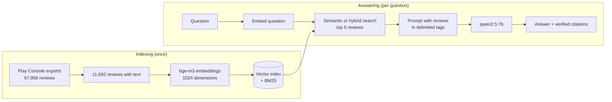

# Glitch RAG

A question-answering service over the real Play Store reviews of
[Glitch!](https://play.google.com/store/apps/details?id=com.lucagrillo.ImageGlitcher),
an Android app for glitch effects on photos and videos that I build and maintain.
It retrieves the relevant reviews, answers **only** from them, and checks every cited
source. Every design choice, from the prompt to the search strategy, is measured
against hand-labelled data.

> Work in progress: a learning project towards production RAG and agent systems on Azure.
> Current state: local models on Ollama. See the [roadmap](#roadmap).

## Why it matters: before and after

Same model (`qwen2.5:7b`), same question: *"How do I export a video in HD with Glitch!?"*

| Without retrieval (`/chat`) | With retrieval (`/ask`) |
|---|---|
| Seven confident steps through menus that do not exist ("Settings → Export → HD") | "The reviews do not explain how to export a video in HD; some users report export problems" |

The model stopped inventing. It now says what its sources do and do not contain.

## How it works



1. **Retrieve**: the question is embedded with `bge-m3` (multilingual) and compared with
   every review by cosine similarity. Optional hybrid mode fuses BM25 keyword search
   with reciprocal rank fusion.
2. **Augment**: the top reviews go into the prompt inside delimited tags, with their id,
   rating, month and app version. Review text is escaped so it cannot close its tag.
3. **Generate**: the model must answer only from the reviews, cite each claim by review
   id, and say so when the sources are not enough.
4. **Verify**: every cited id is checked against the retrieved reviews. Unknown ids are
   returned separately as fabricated citations.

## Results

All numbers come from the evaluation logs in [`docs/`](docs/), judged against
hand-labelled data.

### Review classification (structured output)

20 reviews, 4 per star rating, labelled by hand ([golden set evaluation](docs/Run1/evaluation.md)).

| Field | qwen2.5:1.5b | qwen2.5:7b, initial prompt | qwen2.5:7b, best prompt |
|---|---:|---:|---:|
| Sentiment | 65% | 65% | **75%** |
| Topic | 40% | 65% | 60% |
| Bug report detection | 80% | **100%** | **100%** |
| Invalid JSON | 0/20 | 0/20 | 0/20 |

Six prompt runs, one change at a time; two changes were rejected after error analysis
because they cost a missed bug report or brought no gain
([runs 2–6](docs/Run2/evaluation.md)). A repeat run with no changes gave identical
results, so differences between runs come from the prompt, not from chance.

### Retrieval

Precision@5 on 7 queries in English and Italian ([details](docs/hybrid-search.md)).

| Keyword (BM25) | Semantic | Hybrid (RRF) |
|---:|---:|---:|
| 60% | **94%** | 83% |

Hybrid search did **not** beat semantic search on this data: the corpus is mostly
English, so Italian function words are rare in it and get a high keyword weight.
Semantic search is the default.

### RAG answers

Six questions, retrieval and generation judged separately ([details](docs/rag.md)).

- 0 fabricated citation ids.
- 3 of 3 questions the reviews cannot answer were correctly declined.
- Main open problem: incomplete synthesis. With good sources the model uses on average
  2 of 5 relevant reviews.

## API

| Method | Path | Description |
|---|---|---|
| `POST` | `/ask` | RAG answer with verified citations and the ids of the retrieved reviews |
| `POST` | `/reviews/analyze` | Structured analysis of one review: sentiment, topic, bug report, summary |
| `POST` | `/chat` | Plain chat with the model, no retrieval |
| `POST` | `/chat/stream` | Same as `/chat`, streamed as Server-Sent Events |
| `GET` | `/info` | App name and model in use |
| `GET` | `/health` | Liveness check |

Example:

```bash
curl -s -X POST http://localhost:8000/ask \
  -H "Content-Type: application/json" \
  -d '{"question": "What problems do users report with datamosh?", "mode": "semantic", "k": 5}'
```

Errors from the model provider map to `503` (unreachable), `504` (timeout) and `502`
(invalid output) through one exception handler; streaming errors after the first token
are sent as an SSE `error` event.

## Tech stack

- **Python 3.12**, [uv](https://docs.astral.sh/uv/), FastAPI, Pydantic, pydantic-settings
- **Models** (local, via [Ollama](https://ollama.com)'s OpenAI-compatible API):
  `qwen2.5:7b` for generation, `bge-m3` for embeddings
- **Search**: numpy (exact cosine similarity), `rank-bm25`, reciprocal rank fusion
- **Quality**: pytest with an injected fake model (no model calls in tests), Ruff

The model provider sits behind one client class, so moving to Azure is a configuration
change, not a code change.

## Getting started

Requirements: [uv](https://docs.astral.sh/uv/) and [Ollama](https://ollama.com).

```bash
git clone https://github.com/GrilloLuca/glitch-rag.git
cd glitch-rag
uv sync
cp .env.example .env

ollama pull qwen2.5:7b
ollama pull bge-m3
```

Run the tests (no model needed):

```bash
uv run pytest
```

Start the API:

```bash
uv run fastapi dev app/main.py
```

`/chat`, `/chat/stream` and `/reviews/analyze` work straight away. `/ask` needs a
search index built from Play Console review exports, which are **not included** in
this repository because they are user data. With exports of your own app in
`data/reviews/`:

```bash
uv run python -m scripts.build_index data/reviews
```

Other scripts: `scripts.search` (compare keyword, semantic and hybrid search),
`scripts.sample_reviews`, `scripts.run_analysis` and `scripts.evaluate` (the golden-set
evaluation loop).

## Project structure

```
app/
  main.py            FastAPI app, lifespan, endpoints, error handling
  config.py          typed settings from environment variables
  llm.py             model client: chat, streaming, JSON output, embeddings
  analysis.py        structured review analysis
  rag.py             retrieval-augmented answers and citation checks
  search.py          keyword, semantic and hybrid search
  vector_index.py    normalisation and top-k by cosine similarity
  reviews_source.py  reading Play Console exports
scripts/             indexing, search, analysis and evaluation
tests/               pytest suite with a fake model
docs/                evaluation logs
```

## Data and privacy

Reviews come from my own app's Play Console exports. They are never committed: the
repository contains code, aggregate numbers and short anonymous excerpts in the
evaluation notes only. No API keys or secrets are stored in the repository.

## Roadmap

- [x] FastAPI service, model client, structured output, streaming
- [x] Golden-set evaluation and prompt iterations
- [x] Embeddings, semantic and hybrid search, retrieval evaluation
- [x] RAG endpoint with verified citations
- [ ] Documentation as a second source, with heading-aware chunking
- [ ] Larger golden set and automated evaluation of retrieval and answers
- [ ] Deployment on Azure Container Apps with Managed Identity, Key Vault, monitoring and CI/CD
- [ ] Agent with tools exposed over MCP (e.g. bug reports per effect), multi-agent orchestration and A2A
